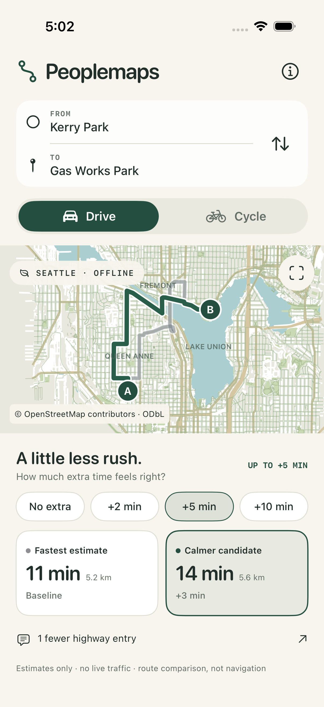

# Peoplemaps

A native iOS route-comparison proof of concept. **Peoplemaps is a working name.**
Choose public Seattle places, compare a fastest estimate with a calmer candidate,
set an extra-time budget, and see the mapped reasons for the difference.

SwiftUI + MapLibre Native + bundled OpenStreetMap data + an owned Swift routing
and comfort-scoring engine. No browser shell, account, paid service, server,
live traffic, location permission, or runtime network connection is required.
Nothing has been published.



## Run on this Mac

Requirements: Xcode with an installed iOS Simulator runtime; Python 3 only if
regenerating the data/project. This baseline was built with Xcode 27.0 (27A266a)
and exercised on an iPhone 17 Pro running the installed iOS 26.5 runtime.
The deployment target is iOS 17; older runtimes and physical devices are untested.

```sh
cd peoplemaps
open Peoplemaps.xcodeproj
```

Choose the **Peoplemaps** scheme and a booted iPhone Simulator, then Run. Xcode
resolves the pinned MapLibre 6.31.0 package on the first build; this requires
network access once. The app itself runs offline. Do not enable signing or
provisioning for Simulator; the project deliberately disables code signing.

Command-line run using the dedicated validation device already created on this
Mac:

```sh
./Scripts/run-simulator.sh D4304B61-4C72-414B-A592-0CC38A9DC2AC
```

The device must be booted. To inspect available devices, use
`DEVELOPER_DIR=/Applications/Xcode.app/Contents/Developer xcrun simctl list devices available`.
Pass any other available booted iPhone UDID to the script when cloning this repo
to another Mac. All scripts set `DEVELOPER_DIR` per command; none changes the
global Xcode selection. Override `PEOPLEMAPS_XCODE` if Xcode is installed elsewhere.

## Try the experience

The opening example is **Kerry Park → Gas Works Park**. With a five-minute budget,
the driving model finds a calmer route at about the same modeled time: two fewer
left turns across traffic without a signal and fewer stop-and-go stops, for one
more left turn at a signal. These are model outputs, not measured travel times.
What "calmer" means for each mode is in [the stress model](Docs/STRESS_MODEL.md).

- Tap either place to search the 519-place offline catalog or select a featured
  public place. No results are sponsored. Search is alphabetical and capped at
  60 visible matches; narrow the query for more specific results.
- Switch Walk / Cycle / Drive. Each mode has its own idea of stress.
- Set No extra / +2 / +5 / +10 minutes. The limit applies to exact modeled
  seconds before display rounding. Sometimes one route is the honest result.
- Tap either route card to highlight it; tap the reason to inspect evidence,
  tradeoffs, street names, endpoint gaps, and unknowns.
- Pan/zoom the map and use the fit button. There is no automatic rerouting.
- Try Fremont Library → Burke Museum for another comparison, or Ballard Library
  → Gas Works Park, which has no distinct lower-cost driving candidate in this
  search even when given more time.

## Test and reproduce

```sh
# Import policy + Swift routing, budget, data, and async lifecycle tests
./Scripts/test.sh

# Add the actual-app XCTest UI suite on a booted dedicated Simulator
./Scripts/test.sh D4304B61-4C72-414B-A592-0CC38A9DC2AC

# Audit three public place pairs × three modes × four budgets
DEVELOPER_DIR=/Applications/Xcode.app/Contents/Developer \
  swift run -c release --jobs 4 peoplemaps-audit > Evidence/route-audit.json

# Rebuild derived OSM files offline from the preserved source archives
python3 Scripts/import_osm.py

# Regenerate Xcode project after adding/removing App or UITests files
python3 Scripts/generate_project.py
```

The project generator uses Python's standard library; XcodeGen, CocoaPods,
Docker, Node, and routing-service installation are unnecessary. The original
compressed OSM responses are committed so clean-clone data generation needs no
public API. `Data/raw/` is an ignored staging area; if present, its corresponding
JSON files are used instead of the archives. Do not refresh casually: preserve
the baseline and use a branch for data changes. Queries and hashes are in `Data/`.

UI tests cover driving/cycling, explanations, no-extra behavior, empty search,
search cancellation and selection, repeated changes, swap, same-place errors,
retry, and cancelling/resuming a comparison. Debug-only launch arguments add a
controlled delay to make cancellation observable; they do not replace the router
or route data. Tests use the real bundled graph. See [verification evidence](Evidence/VERIFICATION.md).

## Scope and honest limitations

This is **route comparison, not navigation**. No route is labeled safe. Driving
route quality, physical-device behavior, accessibility at all text sizes, and
real-world feasibility have not been field validated.

Coverage is a bounded north-central Seattle rectangle: 47.615–47.678 N,
122.390–122.300 W. The 2026-10-11 snapshot compiles to 73,363 nodes and
101,811 street and path segments (162,294 directed walking edges, 64,268 cycling,
47,989 driving) and 519 places. Elevation comes from a bundled ~5 m USGS 3DEP
ground model (public domain); bridges and tunnels are interpolated between their ends. A coverage boundary can exclude routes that
leave and re-enter it. Place positions may be feature centroids, not entrances.
Routes snap to the main connected graph within 400 m. Unrouted endpoint gaps
are disclosed and excluded from times.

Estimates use assumed speeds, hills and junction delays. No live traffic,
closures, parking, signal phases or measured ETA accuracy is available. Signals,
stop signs, turn lanes, crossings and sidewalks come from OSM tags; missing tags
get a small default cost and are disclosed, never treated as facts. Cycle-facility
tags do not verify physical separation. Stop-and-go counts signs and signals,
not traffic queues. Stop-and-go clusters, short freeway hops and side-street
shortcuts are scored on candidate routes but not steered by the search.

The router handles common one-way/access rules and simple via-node restrictions.
It excludes unsupported conditional/via-way restrictions conservatively, but
does not implement every OSM access or maneuver rule. Its six weighted searches
produce candidates; they do not prove an optimal comfortable route under the
time limit. Missing OSM restrictions can still yield infeasible routes.

The UI is optimized for portrait iPhone. No turn-by-turn guidance, background
location, persistence, reviews, photographs, hours, or commercial place
enrichment is implemented.

## Repository guide

- `Core/`: graph models, independent route engine, costs, and cancellation-safe
  session state. A future self-hosted engine can replace `RouteComputing`.
- `App/`: SwiftUI screens and MapLibre bridge. No external place/routing API.
- `Scripts/import_osm.py`: deterministic bounded-data compiler and access policy.
- `Data/`: raw compressed OSM snapshots, queries, provenance, and data licenses.
- `Tests/`, `UITests/`, `Evidence/`: verification and actual-app captures.
- [Architecture and design rationale](Docs/ARCHITECTURE.md)
- [Independent Claude review handoff](CLAUDE_HANDOFF.md)
- [Third-party notices](THIRD_PARTY.md)

Original code is MIT. OSM snapshots and derived databases remain ODbL 1.0;
© OpenStreetMap contributors. MapLibre Native is BSD 2-Clause. The app draws
bundled vectors and makes no public tile requests. Its OSM attribution is visible
and linked on the map. See [data provenance and licensing](Data/LICENSE.md).
