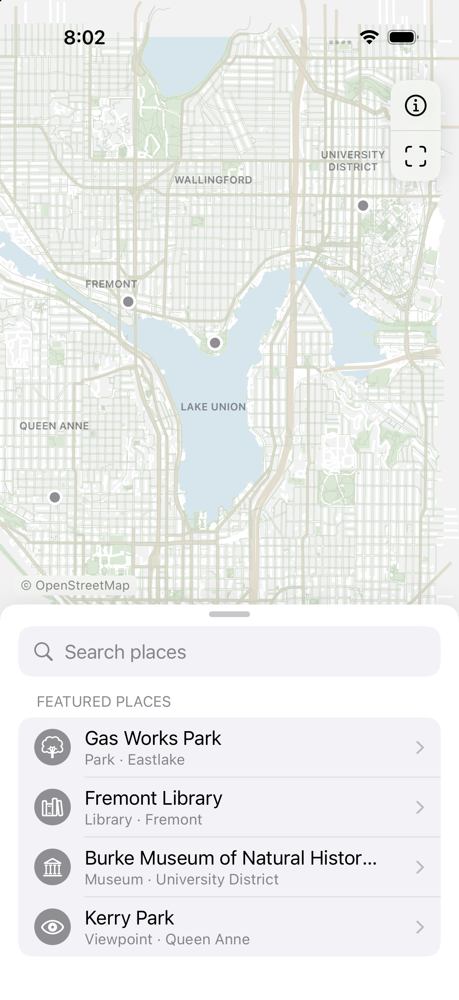
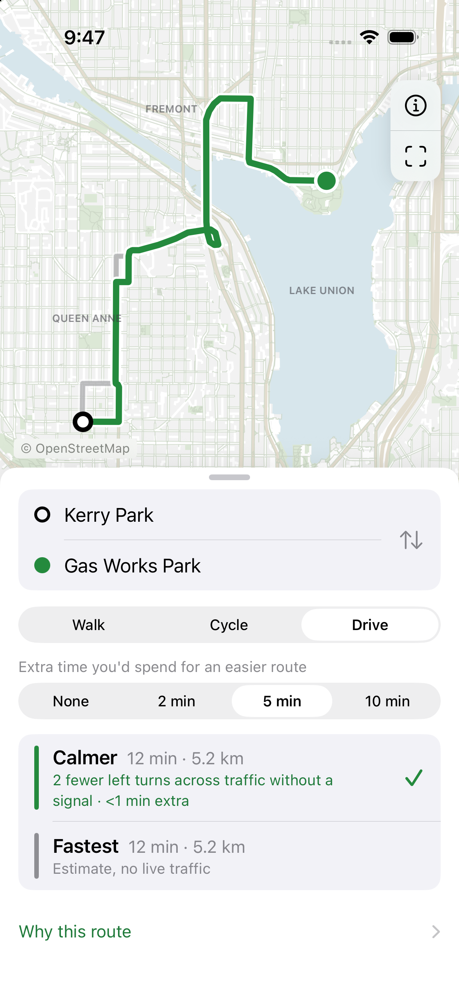
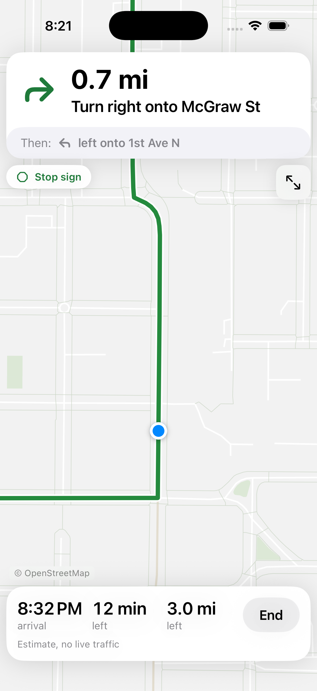
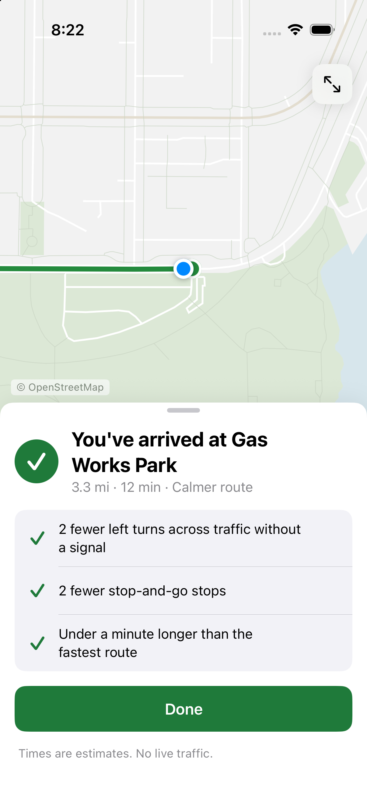

# Peoplemaps

An offline iOS maps app that suggests the route a Seattle local would pick: the
least annoying way, not just the fastest. **Peoplemaps is a working name.**

Walking, cycling and driving each have their own idea of stress (unsignalled
lefts, hill stops, stop-and-go, busy crossings, missing sidewalks, traffic-heavy
bike lanes). The app compares the fastest estimate with a calmer route inside an
extra-time budget, explains the difference in plain language, and guides you
turn by turn with a note on each junction ("Signalled left", "Stop sign"). No
route is ever labelled safe.

<p>
  
  
  
  
</p>

SwiftUI, MapLibre Native, bundled OpenStreetMap and USGS elevation data, our own
Swift router and stress model, and FerrostarCore for navigation progress. No
account, server, paid service or live traffic. The app runs offline; location is
asked for only when you start guidance.

## Run

Requirements: Xcode with an iOS Simulator runtime (built with Xcode 27 on the
iOS 26.5 runtime; deployment target iOS 17, iPhone only). Python 3 only to
regenerate data or the project.

```sh
open Peoplemaps.xcodeproj   # Peoplemaps scheme, any iPhone Simulator
./Scripts/run-simulator.sh <booted-simulator-udid>
```

Xcode resolves the pinned MapLibre 6.31.0 and Ferrostar 0.59.0 packages on the
first build. Signing is not configured yet, so physical devices need your own
team and bundle id. Scripts set `DEVELOPER_DIR` per command; override
`PEOPLEMAPS_XCODE` if Xcode lives elsewhere.

Try **Kerry Park → Gas Works Park**: with five extra minutes the driving model
finds a calmer route with two fewer unsignalled left turns and fewer
stop-and-go stops. Tap Start to follow it; in the Simulator, Debug builds replay
the route.

## Test

```sh
./Scripts/test.sh                       # importer + Swift tests
./Scripts/test.sh <booted-simulator-udid>   # plus the UI suite
python3 Scripts/import_osm.py           # rebuild the graph from the archived OSM snapshots
python3 Scripts/generate_project.py     # regenerate the Xcode project after adding files
DEVELOPER_DIR=/Applications/Xcode.app/Contents/Developer \
  swift run -c release peoplemaps-audit > Evidence/route-audit.json
```

UI tests drive the real app on the real graph: search, compare, all modes,
budgets, cancellation, simulated guidance to arrival, location permission
allowed and denied, moving GPS, a forced reroute, and leaving and returning to
the app. Debug-only launch arguments (`--ui-testing`, `--simulate-route`,
`--fast-simulation`, `--real-location`) control this; they never replace the
router or data.

## Limits

- Coverage is north-central Seattle only (47.615–47.678 N, 122.390–122.300 W).
- Times are estimates from assumed speeds, hills and junction delays; there is
  no live traffic, closures or signal timing.
- Signals, stops, crossings, sidewalks and bike facilities come from OSM tags.
  Missing tags are disclosed as unknown, never treated as facts.
- Whole-route factors (stop-and-go clusters, short freeway hops, cut-throughs)
  are scored on candidates but don't steer the search.
- Guidance is foreground-only and hasn't been tested on a real phone yet.

## Repository guide

- `Core/`: graph models, router, [stress model](Docs/STRESS_MODEL.md), navigation plan.
- `App/`: SwiftUI screens, MapLibre bridge, `Navigation/` (Ferrostar adapter and guidance).
- `Scripts/`: OSM importer, project generator, test and run scripts.
- `Data/`: OSM snapshots, elevation model, queries, provenance and licences.
- `Tests/`, `UITests/`, `Evidence/`: tests, route audit, screenshots.
- Docs: [architecture](Docs/ARCHITECTURE.md), [navigation](Docs/NAVIGATION.md), [search](Docs/SEARCH.md),
  [Apple practices audit](Docs/RESEARCH_UX_2026.md), [third-party notices](THIRD_PARTY.md).

Original code is MIT. OSM data and derived files are ODbL 1.0, © OpenStreetMap
contributors. Elevation is USGS 3DEP (public domain). MapLibre Native is BSD
2-Clause; Ferrostar is BSD 3-Clause. See [data licensing](Data/LICENSE.md).
