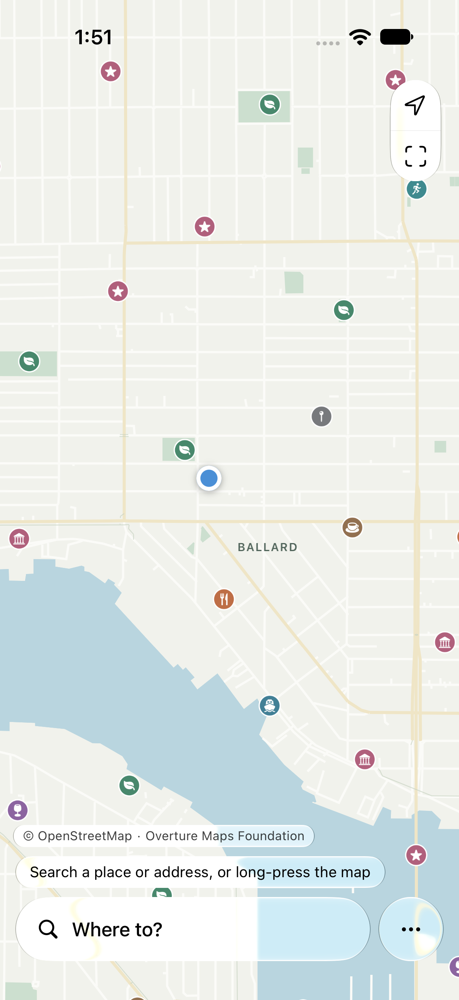
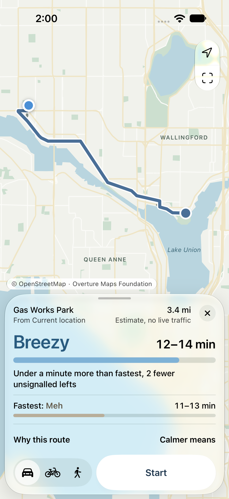
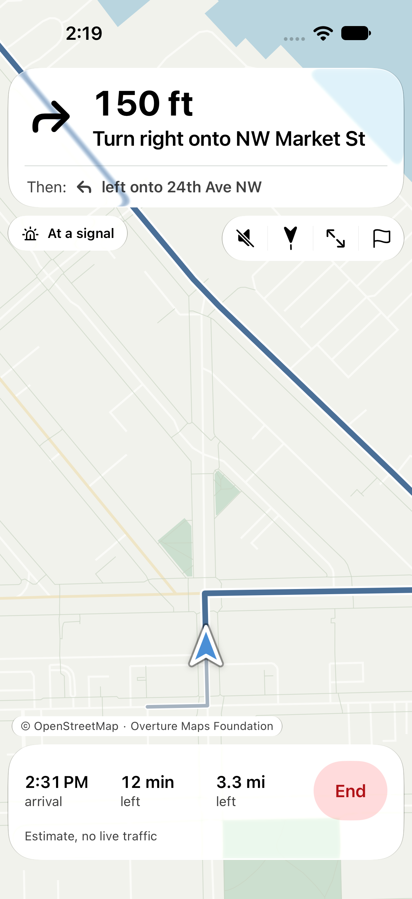

# Peoplemaps

An offline iOS maps app that suggests the route a Seattle local would pick: the
least annoying way, not just the fastest. **Peoplemaps is a working name.**

Walking, cycling and driving each have their own idea of stress (unsignalled
lefts, hill stops, stop-and-go, busy crossings, missing sidewalks, traffic-heavy
bike lanes). The app compares the fastest estimate with a calmer route inside an
extra-time budget, explains the difference in plain language, and guides you
turn by turn with a note on each junction ("Signalled left", "Stop sign"). No
route is ever labelled safe.

<p>
  
  
  
</p>

SwiftUI, MapLibre Native, bundled OpenStreetMap and USGS elevation data, our own
Swift router and stress model, and FerrostarCore for navigation progress. No
account, ads, analytics or live traffic. Maps, search and routing run offline on
the phone; location is asked for only when you start guidance.

The app contacts a server in two cases, both started by a tap in Settings: to
download the larger King County map, and to send a trip log you chose to keep.
The server is a small Cloudflare Worker in `Backend/`. What it receives and keeps
is in the [privacy policy](Docs/PRIVACY.md).

## Run

Requirements: Xcode with an iOS Simulator runtime (built with Xcode 27 on the
iOS 27 runtime; deployment target iOS 27, iPhone only). Python 3 only to
regenerate data or the project.

```sh
open Peoplemaps.xcodeproj   # Peoplemaps scheme, any iPhone Simulator
./Scripts/run-simulator.sh <booted-simulator-udid>
```

Xcode resolves the pinned MapLibre 6.31.0 and Ferrostar 0.59.0 packages on the
first build. Signing is automatic and the project sets no team; the bundle ID is
`electrocorp.peoplemaps`. To install on a phone, pass `DEVELOPMENT_TEAM=<your team>` to
`xcodebuild` or pick your team in Xcode's Signing tab. Scripts set `DEVELOPER_DIR` per command; override
`PEOPLEMAPS_XCODE` if Xcode lives elsewhere.

Try **Kerry Park → Gas Works Park** (search Gas Works, tap Directions, and pick
Kerry Park as the start if you are not there): with five extra minutes the driving model
finds a calmer route with two fewer unsignalled left turns and fewer
stop-and-go stops. Tap Start to follow it; in the Simulator, Debug builds replay
the route.

## Test

```sh
Scripts/verify.sh                       # importer, data reproduction, Swift tests, iOS build
Scripts/verify.sh --ui                  # plus the UI suite on a "PeopleMaps Verify" simulator
(cd Backend && npm ci && npm test)      # the Worker's tests, under node
python3 Scripts/import_osm.py           # rebuild the graph from the archived OSM snapshots
python3 Scripts/generate_project.py     # regenerate the Xcode project after adding files
DEVELOPER_DIR=/Applications/Xcode.app/Contents/Developer \
  swift run -c release peoplemaps-audit > Evidence/route-audit.json
```

UI tests drive the real app on the real graph: search, compare, all modes,
budgets, cancellation, simulated guidance to arrival, location permission
allowed and denied, moving GPS, a forced reroute, and leaving and returning to
the app. Debug-only launch arguments (`--ui-testing`, `--simulate-route`,
`--fast-simulation`, `--real-location`) control this; they never replace the
router or data.

## Limits

- Coverage is Seattle, or King County and a little beyond once that map is
  downloaded in Settings. What is in git is a small test fixture of north-central
  Seattle (47.615–47.678 N, 122.390–122.300 W); a build bundles all of Seattle when
  `Scripts/fetch_data seattle-all` has fetched it (see
  [architecture](Docs/ARCHITECTURE.md), Region data).
- Times are estimates from assumed speeds, hills and junction delays; there is
  no live traffic, closures or signal timing.
- Signals, stops, crossings, sidewalks and bike facilities come from OSM tags.
  Missing tags are disclosed as unknown, never treated as facts.
- Whole-route factors (stop-and-go clusters, short highway hops, cut-throughs)
  are scored on candidates but don't steer the search.
- Guidance is foreground-only. It is being tested on the owner's phone; there is
  no TestFlight or App Store build yet.

## Repository guide

- `Core/`: the `PeoplemapsCore` Swift package. Graph models, router, [stress model](Docs/STRESS_MODEL.md),
  navigation plan, search, region downloads, problem reports and trip logs.
- `App/`: SwiftUI screens, MapLibre bridge, `Navigation/` (Ferrostar adapter and guidance), `Settings/`, `Reports/`.
- `Backend/`: the Cloudflare Worker that serves region downloads and receives sent trip logs ([its README](Backend/README.md)).
- `Scripts/`: OSM importer, search and tile builders, project generator, `verify.sh`.
- `Data/`: OSM snapshots, elevation model, queries, region manifest, provenance and licences.
- `Tests/`, `UITests/`: the package's tests and the app's UI tests.
- `Tools/`, `Bench/`, `LogKey/`: command-line tools. `peoplemaps-audit` writes `Evidence/route-audit.json`,
  `peoplemaps-bench` times the router ([performance](Docs/PERFORMANCE.md)), `peoplemaps-logkey` opens sent logs.
- Docs: [architecture](Docs/ARCHITECTURE.md), [design](Docs/DESIGN.md), [navigation](Docs/NAVIGATION.md),
  [search](Docs/SEARCH.md), [reports and logs](Docs/REPORTS.md), [privacy](Docs/PRIVACY.md),
  [third-party notices](THIRD_PARTY.md). Finished research and spikes are in `Docs/archive/`.

Original code is MIT. OSM data and derived files are ODbL 1.0, © OpenStreetMap
contributors. Elevation is USGS 3DEP (public domain). MapLibre Native is BSD
2-Clause; Ferrostar is BSD 3-Clause. See [data licensing](Data/LICENSE.md).
